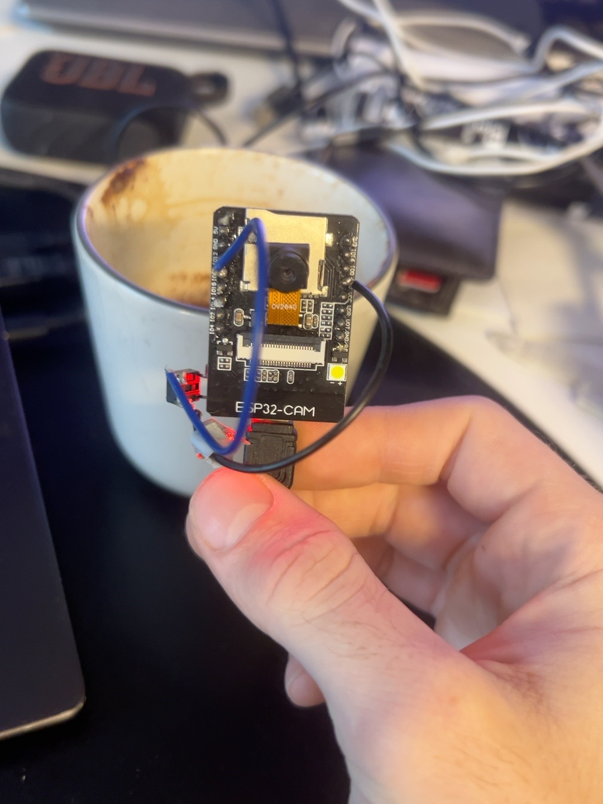

# ESP32 camera initialisation and photo capture
## learnings:
- **#include**	Makes library declarations available, in this case esp32 library
- **#define**	Defines constants or macros for the preprocessor, gives names of functions on esp32 the assigned GPIO pin
- **struct**	Groups multiple related data into one data structure e.g. when used camera_config_t config = {};
- **&config**	Gets the memory address of config - config is the variable, and &config gives the address of the variable config 
- ***photo**	Declares a pointer to a frame buffer. **camera_fb_t *photo = esp_camera_fb_get();** camera_fb_t — a structure defined by the camera library. *photo — declares photo as a pointer. esp_camera_fb_get() — returns the memory address of a captured frame buffer. So photo stores the memory address of the frame buffer, rather than the frame buffer itself.
- **esp_camera_fb_return()**	Returns the frame buffer (where image temporarily stored) to the camera driver, config.fb_count = 1; means only one frame buffer and gets overwritten with every photo taken


# Connecting ESP32 to wifi
## Seperating secrets from main program 
- inside .gitignore simply write the name of the file wishing to be ignored by . In this case = **secrets.h** . github wont allow file called secret.h to be pushed. 
- .h stands for header file commonly used for declarations and configuration that other files can include 
- **include guard** - #ifndef SECRETS_H #define SECRETS_H : SECRETS_H isn't a variable. It's a preprocessor macro. like the GPIO names. if SECRETS_H is not defined, define it. This gets done once on compilation but then not again. This is so declaration or definitons doesnt occur twice, potentially casuing errors

**const char* WIFI_SSID = "YOUR_WIFI_NAME";**
- char = data type respresenting single charcter 
- * = declares pointer variable that points to a string of characters (const char* = pointer to constant character array, meaning the string cannot be modified)
- WIFI_SSD = variable name

#include <WiFi.h> //existing library for wifi connection
#include "secrets.h" //include code from another file (the secrets.h file that contains the wifi credentials)


# Send text over WiFi
Creation of web server: which allows another device (your computer, phone or eventually your CalorieTracker app) to request information from the ESP32, over the same wifi network only. 
- `#include <WebServer.h>`

- `WebServer server(80);` - WebServer — A library class for creating a web server on the ESP32. server — The object (variable) created from that class. 80 — The port number the server listens on (default for HTTP).
- `server.on("/", ...)` — Defines what happens when someone visits the ESP32's homepage (`/`).
- `[]() {}` — Lambda function (unnamed function) that runs when the URL is requested.
- `server.send(200, "text/plain", "Hello from CalorieSense!")` — Sends a successful HTTP response (`200`) containing plain text.
- `server.begin()` — Starts the web server, allowing it to accept connections.

# Send image instead of text over wifi
server.on("/capture", []() {
    
  camera_fb_t *photo = esp_camera_fb_get();


  if (photo == nullptr) {
    server.send(500, "text/plain", "Camera capture failed");
    return;
  }

  server.sendHeader("Content-Disposition", "inline; filename=photo.jpg");
  server.setContentLength(photo->len);
  server.send(200, "image/jpeg", "");

  server.client().write(photo->buf, photo->len);

  esp_camera_fb_return(photo);
});

server.begin();


`server.on("/capture", []() {` — Creates the /capture URL route. When visited, the ESP32 runs the lambda function to capture and send a photo. A lambda is essentially a function you can define directly where it's needed, without giving it a name.


`camera_fb_t *photo = esp_camera_fb_get();` — Creates a pointer called photo to a camera frame-buffer structure (camera_fb_t). The function obtains a captured image and returns its memory address.

`if (photo == nullptr) {` — Checks whether capturing failed. nullptr means the pointer doesn't point to a valid object.

`server.send(500, "text/plain", "Camera capture failed");` — Sends an HTTP 500 error with a plain-text message if the camera fails.

`return;` — Exits the function early, preventing the remaining code from running.

`server.sendHeader("Content-Disposition", "inline; filename=photo.jpg"); `— Adds an HTTP header suggesting the browser display the image directly (inline) and use photo.jpg as its filename if saved.

`server.setContentLength(photo->len);` — Specifies the image size in bytes (photo->len), telling the browser how much data to expect.

`server.send(200, "image/jpeg", "");` — Sends a successful HTTP response (200) with JPEG content type. The empty string means the image bytes will be sent separately.

`server.client().write(photo->buf, photo->len);` — shorthand for `(*photo).len` and `(*photo).buf` Sends the actual image bytes to the connected client. photo->buf points to the image data, and photo->len specifies the number of bytes to send.

`esp_camera_fb_return(photo);` — Returns the frame buffer to the camera driver so its memory can be reused.

`});` — Closes the lambda function and the server.on() call.

`server.begin();` — Starts the ESP32 web server, allowing it to accept incoming HTTP connections.


# Connecting Button to camera
Welded on a button to GPIO 13 pin on the left side and GND on the right side of ESP32 as seen: 


now to add in the code:
- `const int BUTTON_PIN = 13;` - constant (value which cannot be changed) named BUTTON_PIN with the value 13 (GPIO 13)

- `pinMode(BUTTON_PIN, INPUT_PULLUP);` - pinMode() is an arduino function telling esp32 how to use a particular pin pinMode(pin, mode). Mode = how you want pin to behave. Pin to configure = BUTTON_PIN (13). INPUT_PULLUP tells the ESP32 that GPIO 13 is an internal pull up resistor. Button pressed = low and button released = high, relating to voltage level 

 `if (digitalRead(BUTTON_PIN) == LOW) { Serial.println("Button pressed!"); } ` - digitalRead() is a function that detects whether a GPIO pin is high or low. This is inside the loop so constantly checking whether voltage is low from GPIO 13. 


# Pointers explained 
camera_fb_t *photo = esp_camera_fb_get();


1. camera_fb_t — The data type
This is a struct defined by the ESP32 camera library.

It contains information about a photograph, including:
- buf — Pointer to the actual image data.
- len — Size of the image in bytes.
- width — Image width in pixels.
- height — Image height in pixels.
2. *photo — Declares a pointer variable
Normally, you might write:
int age = 22;


Here, age directly stores the number 22.

But with:
camera_fb_t *photo;


You're creating a variable called photo that stores a memory address rather than a camera_fb_t structure itself.

The * tells C++ that photo is a pointer to a camera_fb_t object.
3. esp_camera_fb_get() — The function
This function is provided by the ESP32 camera library.

It obtains a captured image and returns a pointer to the frame-buffer structure containing information about that image.
4. = — Assigns the returned address
camera_fb_t *photo = esp_camera_fb_get();


This means:
1. Call esp_camera_fb_get().
2. The camera driver obtains a photograph.
3. The function returns the memory address of its frame-buffer structure.
4. Store that address in the pointer variable photo.
5. How do we use the pointer?
Imagine the photograph's frame-buffer structure is stored at memory address 0x2000.
Illustrative memory address and image values.
Because photo is a pointer, we access its fields using ->:
Serial.println(photo->width);  // 640
Serial.println(photo->height); // 480
Serial.println(photo->len);    // 45000


The -> operator means follow the pointer to the structure, then access the specified field.
6. Why use a pointer instead of storing the photograph directly?
Because the camera driver already manages the frame buffer in memory.

Rather than copying it, the function gives us a pointer to access it directly.

This is more efficient, particularly on an ESP32 where memory is limited.

Important: The two meanings of *
In C++, the asterisk can mean different things depending on where it's used.
camera_fb_t *photo;   // Declares a pointer


But:
*photo;               // Dereferences the pointer


Dereferencing means accessing the actual object at the memory address stored in the pointer.


# App Development using Expo Go 
## Expo Go
- 'node -v' to check if nofe.js is downloaded in vs terminal
'npx.cmd create-expo-app@latest mobile' 
- adding on cmd bypasses powershell script restrictions
- npx — Runs a package without requiring a global installation.
- create-expo-app — Expo's tool for creating React Native projects.
- @latest — Uses the latest version of the project creation tool.
mobile — Names the new project folder.
- cd mobile - opens cd file path in vs terminal - this is where packages are to run expo

Expo automatically creates a React Native project template when you run npx create-expo-app.
Here's what matters:
- src/ — Where you write your app's code.
- assets/ — Images, icons and fonts.
- node_modules/ — Downloaded libraries your app uses.
- package.json — Lists libraries and commands for your project.
- package-lock.json — Records exact library versions.
- app.json — App settings (name, icon, etc.).
- tsconfig.json — TypeScript configuration.
- .gitignore — Files Git shouldn't upload to GitHub.
- README.md — Project documentation.
Key point: Expo creates the basic structure so you can focus on building your app.

run **npx.cmd expo start** inside \mobile route of project

# Next steps:
1. Get the ESP32 saving a photograph locally when you press the button.
2. Implement a queue of up to 10 photographs.
3. Connect Supabase and create an upload endpoint.
4. Automatically upload queued photos when connected to Wi-Fi.
4. Analyse photographs using OpenAI.
5. Display the results in your Expo app.


# ESP32-CAM: Saving Photos to microSD

- **`#include "SD_MMC.h"`** — library for accessing the ESP32's microSD card.
- **`#include "FS.h"`** — provides file system operations.
- **`SD_MMC.begin("/sdcard", true)`** — initialises the SD card in 1-bit mode, leaving GPIO13 available for the button.
- **`esp_camera_fb_get()`** — captures a photo into a frame buffer (temporary memory).
- **`SD_MMC.open("/photo.jpg", FILE_WRITE)`** — creates/opens a file for writing.
- **`file.write(photo->buf, photo->len)`** — writes the JPEG image bytes to the file.
- **`file.close()`** — closes the file.
- **`esp_camera_fb_return(photo)`** — releases the camera buffer's memory.

### Project progress
- Formatted microSD card to FAT32.
- Successfully initialised the SD card.
- Physical button now captures and saves a JPEG.
- Removed the unnecessary HTTP web server.

### photo counter - added a counter for photos: photo1, photo2 etc. so photos dont get overwritten, not overwritten after resettign aswell
### web access removal - removed uploading to IP address and ip/capture
### offline mode - removed requirement for wifi to be connected for program to run


# Progress
[x] Set up ESP32-CAM and physical button
[x] Capture photos and save to microSD
[x] Give photos unique filenames
[x] Allow photo capture without Wi-Fi
[ ] Set up Supabase (storage, database and backend function)
[ ] Connect ESP32 to Supabase and upload photos
[ ] Automatically retry failed uploads and delete successfully uploaded photos from SD
[ ] Integrate OpenAI API to estimate calories and nutrients
[ ] Build Expo mobile app to display meals and nutritional data
[ ] Add user authentication and secure API access
[ ] Optimise battery life (Wi-Fi scheduling - attempt to connect to wifi every 15 mins/when button clicked twice maybe?, sleep modes, may need to move button to GPIO pin which wakes device from deep sleep, 13 doesnt do this at the moment)
[ ] Test complete system end-to-end


# Supabase
in supabase: storage -> bucket created named food-photos (cloud folder where JPEG images will be stored)
edge functions -> deploy a new function -> Via editor -> function name = upload-photo 
### test
replaced code with: 
Deno.serve((_req) => {
  return new Response(
    JSON.stringify({ message: "CalorieTracker backend is working!" }),
    {
      headers: { "Content-Type": "application/json" },
    }
  );
});

- Deno.serve() — starts a function that handles incoming HTTP requests.
- _req — represents the incoming request (we aren't using it yet).
- Response — sends a response back to whoever called the function.
- JSON.stringify() — converts a JavaScript object into JSON.

-> click test -> HTTP = POST -> leave request body as is or leave empty -> send request -> check working

Before moving on need to make sure strangers cant upload files to this storage so will use **device-specific secret token** that the esp32 sends with each request

## create a secret in supabase
edge functions-> secrets -> new secret named DEVICE_UPLOAD_TOKEN -> value = make it random

## new code with secrets:
Deno.serve((req) => {
  // Get the token sent by the ESP32
  const providedToken = req.headers.get("x-device-token");

  // Get the correct token stored in Supabase
  const correctToken = Deno.env.get("DEVICE_UPLOAD_TOKEN");

  // Reject requests without the correct token
  if (!correctToken || providedToken !== correctToken) {
    return new Response("Unauthorized", { status: 401 });
  }

  return new Response(
    JSON.stringify({ message: "Device authenticated!" }),
    {
      headers: { "Content-Type": "application/json" },
    }
  );
});

- req.headers.get() reads information sent with an HTTP request.
- Deno.env.get() retrieves a secret stored in Supabase.
- !== means not equal to.
- 401 is the HTTP status code for an unauthorised request.


test with example request body -> should give 401 unauthorised 
test with header x-device-token and header value 'my value' -> 200 OK

## new code 
### test that our backend can receive the actual image data from the ESP32, rather than just a message.

Deno.serve(async (req) => {
  const providedToken = req.headers.get("x-device-token");
  const correctToken = Deno.env.get("DEVICE_UPLOAD_TOKEN");

  if (!correctToken || providedToken !== correctToken) {
    return new Response("Unauthorized", { status: 401 });
  }

  // Read the uploaded photo as binary data
  const photo = await req.arrayBuffer();

  // Check that a photo was actually received
  if (photo.byteLength === 0) {
    return new Response("No photo received", { status: 400 });
  }

  return Response.json({
    message: "Photo received!",
    bytes: photo.byteLength,
  });
});

- async — allows the function to wait for operations.
- await req.arrayBuffer() — reads the incoming binary data (the JPEG).
- photo.byteLength — tells us how many bytes were received.
- 400 — indicates an invalid request.

## new code again
### The previous code only received the photo. The new code saves it to Supabase Storage.

import { createClient } from "npm:@supabase/supabase-js@2";

Deno.serve(async (req) => {
  // 1. Check the device token
  const providedToken = req.headers.get("x-device-token");
  const correctToken = Deno.env.get("DEVICE_UPLOAD_TOKEN");

  if (!correctToken || providedToken !== correctToken) {
    return new Response("Unauthorized", { status: 401 });
  }

  // 2. Read the photo
  const photo = await req.arrayBuffer();

  if (photo.byteLength === 0) {
    return new Response("No photo received", { status: 400 });
  }

  // 3. Connect to Supabase Storage
  const supabase = createClient(
    Deno.env.get("SUPABASE_URL")!,
    Deno.env.get("SUPABASE_SERVICE_ROLE_KEY")!
  );

  // 4. Generate a unique filename
  const filename = `${crypto.randomUUID()}.jpg`;

  // 5. Save the photo
  const { error } = await supabase.storage
    .from("food-photos")
    .upload(filename, photo, {
      contentType: "image/jpeg",
    });

  if (error) {
    return new Response(error.message, { status: 500 });
  }

  return Response.json({
    message: "Photo saved successfully!",
    filename: filename,
  });
});

- createClient()	Connects the function to your Supabase project
- SUPABASE_SERVICE_ROLE_KEY	Gives the backend permission to write to private Storage
- crypto.randomUUID()	Creates a unique filename
- .from("food-photos")	Selects your storage bucket
- .upload()	Saves the JPEG to the bucket


### 29/10/26
- back after a few days, supabase got paused so had to resume, may need to upgrade in the future 


## check if photo is JPEG 
for simplicity, security and efficiency 

`const bytes = new Uint8Array(photo); `

`if (`
  `bytes.length < 4 ||`
  `bytes[0] !== 0xFF ||`
  `bytes[1] !== 0xD8 ||`
  `bytes[2] !== 0xFF`
`) {`
  `return new Response("Invalid JPEG image", { status: 400 });   }`

- `Uint8Array(photo)` lets us inspect the individual bytes.
- `0xFF, 0xD8, 0xFF` are the starting bytes normally found in a JPEG file.
- `400` means the request contains invalid data.


# Sending photo to supabase

`#include <HTTPClient.h>` - This lets my ESP32 send HTTP requests to a server.
My ESP32 will eventually use an HTTP POST request to send JPEG data to the upload-photo Edge Function.

`const char* SUPABASE_UPLOAD_URL = "https://YOUR-PROJECT-ID.supabase.co/functions/v1/upload-photo";` 
const char* DEVICE_UPLOAD_TOKEN = "YOUR_DEVICE_TOKEN";
- added in these with appropriate values and links within the #define SECRETS_H function

## Supbase Authentication
### JWT vs Device Token

**Why does Supabase have two authentication methods?**

1. **JWT (JSON Web Token):** Supabase's built-in authentication system. JWTs are commonly used to verify logged-in users.
2. **Device token:** Our own secret password that identifies an authorised ESP32-CAM.

**How our project works:**

- We disable Supabase's built-in JWT verification for the `upload-photo` Edge Function.
- The ESP32 sends its secret token in an HTTP header called `x-device-token`.
- The Edge Function compares that token with `DEVICE_UPLOAD_TOKEN`, securely stored in Supabase.
- If they match → request accepted.
- If they don't match → `401 Unauthorized`.

**Why disable JWT verification?**

Our ESP32 isn't a logged-in user, so it doesn't have a user JWT. Instead, we're using a simpler device-token authentication system.

**Important:** Disabling JWT verification doesn't automatically make uploads unrestricted because our Edge Function still checks the device token. However, the endpoint is publicly reachable, so the token must remain secret and further security measures may be needed for production.

**Key lesson:** Authentication verifies *who or what is making a request*. JWTs and custom device tokens are two different ways of doing this.

## Function whis is called after photo taken called uploadPhoto

//function which is called after the photo is taken, if no wifi, stays on sd card as already done, else opens file
// creates a fucntion that accepts a filename
void uploadPhoto(String filename) {

  // Only attempt uploads when connected to Wi-Fi
  if (WiFi.status() != WL_CONNECTED) {
    Serial.println("No Wi-Fi. Photo stays on SD card.");
    return;
  }
String wifiName = WiFi.SSID();
String ipName = WiFi.localIP().toString();
Serial.println("Still connected to Wi-Fi: " + wifiName + " with IP: " + ipName);

  // Open an existing photo from the SD card
  File file = SD_MMC.open(filename, FILE_READ);

  if (!file) {
    Serial.println("Could not open photo!");
    return;
  }

  Serial.print("Ready to upload: ");
  Serial.println(filename);
  Serial.print("Photo size: ");
  Serial.println(file.size());
  file.close();


## Then adding at the end of this for the actual send
Serial.println(file.size());

// Create a secure HTTPS connection
WiFiClientSecure client;
client.setInsecure();  // Testing only: skips certificate verification

HTTPClient http;

// Connect to our Supabase Edge Function
if (!http.begin(client, SUPABASE_UPLOAD_URL)) {
  Serial.println("Could not start HTTP connection.");
  file.close();
  return;
}

// Add the headers expected by our Edge Function
http.addHeader("Content-Type", "image/jpeg");
http.addHeader("x-device-token", DEVICE_UPLOAD_TOKEN);

// Send the JPEG bytes directly from the SD card
int responseCode = http.sendRequest("POST", &file, file.size());

// Check Supabase's response
Serial.print("HTTP response: ");
Serial.println(responseCode);

if (responseCode == 200) {
  Serial.println("Photo uploaded successfully!");
  Serial.println(http.getString());
} else {
  Serial.println("Upload failed. Photo remains on SD card.");
  Serial.println(http.getString());
}

// Close the connections
http.end();
file.close();

- WiFiClientSecure	Creates an HTTPS connection
- HTTPClient	Builds and sends the HTTP request
- http.addHeader()	Adds information such as your device token
- http.sendRequest("POST", &file, file.size())	Streams the JPEG from the SD card to Supabase
- responseCode == 200	Checks whether Supabase reported success
- http.end()	Closes the HTTP connection


## function to list all photos on the sd card
//function to list all the photos on the SD card, prints the names of all files in the root directory of the SD card to the serial monitor.
void listPhotos() {
  File root = SD_MMC.open("/");

  File file = root.openNextFile();

  while (file) {
    //only print the name of the file if it is not a directory and has a .jpg extension
    if (!file.isDirectory() && String(file.name()).endsWith(".jpg")) {
      Serial.println(file.name());
    }
    file = root.openNextFile();
  }

  root.close();
}


## delete photo just taken 
### add onto end of upload photo function
// Only delete the local photo if Supabase confirmed success
if (responseCode == 200) {
  if (SD_MMC.remove(filename)) {
    Serial.println("Deleted from SD card: " + filename);
  } else {
    Serial.println("Failed to delete: " + filename);
  }
}


## upload pending photos 
// Upload all JPEG photos currently on the SD card
void uploadPendingPhotos() {

  // Don't attempt uploads without Wi-Fi
  if (WiFi.status() != WL_CONNECTED) {
    return;
  }

  // Open the SD card's root directory
  File root = SD_MMC.open("/");

  // Find the first file
  File file = root.openNextFile();

  while (file) {

    if (!file.isDirectory() && String(file.name()).endsWith(".jpg")) {

      String filename = "/" + String(file.name());

      // Close the file before uploading it
      file.close();

      // Reuse our existing upload function
      uploadPhoto(filename);

    } else {
      file.close();
    }

    // Move to the next file
    file = root.openNextFile();
  }

  root.close();
}


## changed to this so no files are skipped

void uploadPendingPhotos() {

  if (WiFi.status() != WL_CONNECTED) {
    return;
  }

  while (true) {

    File root = SD_MMC.open("/");
    File file = root.openNextFile();

    String filename = "";

    // Find the first JPEG
    while (file) {

      if (!file.isDirectory() && String(file.name()).endsWith(".jpg")) {
        filename = "/" + String(file.name());
        file.close();
        break;
      }

      file.close();
      file = root.openNextFile();
    }

    root.close();

    // No more photos to upload
    if (filename == "") {
      break;
    }

    uploadPhoto(filename);

    // Stop if the photo is still there (upload or deletion failed)
    if (SD_MMC.exists(filename)) {
      Serial.println("Photo still pending. Stopping retries.");
      break;
    }
  }
}

## upload pending photos - run in loop
### created `bool wasWifiConnected = false;`

  bool wifiConnected = (WiFi.status() == WL_CONNECTED);

  if (wifiConnected && !wasWifiConnected) {
    Serial.println("Wi-Fi connected! Checking for pending photos...");
    uploadPendingPhotos();
  }

  wasWifiConnected = wifiConnected;


### Problem discovered — Battery consumption

The ESP32 currently runs `loop()` continuously, repeatedly checking Wi-Fi status and the physical button.

I questioned whether checking Wi-Fi constantly would waste battery.

**Key learning:** Repeatedly checking `WiFi.status()` isn't the biggest power drain. Keeping the ESP32 processor and Wi-Fi radio awake continuously consumes much more energy.

Checking Wi-Fi only once in `setup()` would reduce unnecessary polling, but would not significantly improve battery life unless the device also enters a low-power state.

There is also a timing issue: Wi-Fi sometimes connects after the five-second startup timeout. A single check could miss that connection.

### Planned solution — Deep sleep

The eventual battery-powered design should:

1. Remain in deep sleep when idle.
2. Wake when the physical button is pressed.
3. Capture and save the photo to the SD card.
4. Attempt Wi-Fi for a limited period.
5. Upload any pending photos if connected.
6. Return to deep sleep.

**Hardware consideration:** GPIO13, currently used for the button, isn't a standard deep-sleep external wake-up pin on the original ESP32. Button wiring may need changing.

### Further improvements
- Test automatic uploads of photos captured offline.
- Replace `client.setInsecure()` with proper HTTPS certificate verification.
- Verify that the full JPEG was written successfully to the SD card.
- Implement deep sleep and measure battery consumption.
- Consider how to retry failed uploads without unnecessary Wi-Fi activity.

**Main takeaway:** A working prototype isn't necessarily an efficient finished product. Power consumption, reliable retries, file handling and security are important parts of embedded-system design.


### Problem Fixed — Camera Uploading Previous Photo

**Problem:** The ESP32-CAM was uploading the previous image rather than the scene currently in front of the camera.

**Cause:** The camera was likely returning an old (stale) frame from its frame buffer.

**Solution:** Capture and discard the first frame, then capture a fresh one.

instead of just: `camera_fb_t *photo = esp_camera_fb_get();`

i did :


```cpp
camera_fb_t *photo = esp_camera_fb_get();

if (photo != nullptr) {
  esp_camera_fb_return(photo);
}

photo = esp_camera_fb_get();
```

**Learning:**
- `esp_camera_fb_get()` retrieves a camera frame buffer.
- `esp_camera_fb_return()` releases that buffer back to the camera driver.
- Discarding the first frame allows us to request a fresher image.

**Result:** Photos now match what the camera is pointing at when the button is pressed.


# CalorieTracker — Development Roadmap

**Last updated:** 29 October 2026

## Current Progress — Working ESP32 Prototype

### Completed
- [x] ESP32-CAM captures photos using a physical button.
- [x] Photos saved to microSD as JPEG files.
- [x] Photos uploaded to Supabase through an Edge Function.
- [x] Successful uploads deleted from the SD card.
- [x] Unique filenames prevent overwriting existing SD photos.
- [x] Camera stale-frame issue fixed by discarding the first frame.
- [x] `listPhotos()` function implemented.
- [x] `uploadPendingPhotos()` function implemented.
- [x] Wi-Fi connection detection added to `loop()`.

**Current status:** Core camera-to-cloud upload works. Offline recovery and automatic pending uploads still need full testing.

---

## Phase 1 — Reliable ESP32 Uploads

- [x] Test taking photos without Wi-Fi.
- [x] Confirm offline photos remain on the SD card.
- [x] Restore Wi-Fi and check automatic uploads.
- [x] Test uploading multiple pending photos.
- [ ] Confirm failed uploads are retained for retrying.
- [ ] Improve Wi-Fi reconnection handling.
- [ ] Handle SD card failures and incomplete photo writes.

**Goal:** Never lose a photo because Wi-Fi is unavailable.

## Phase 2 — Battery Optimisation

- [ ] Choose battery and charging hardware.
- [ ] Investigate deep-sleep-compatible wake-up pins.
- [ ] Implement ESP32 deep sleep.
- [ ] Wake ESP32 using the physical button.
- [ ] Capture and save photos after waking.
- [ ] Connect to Wi-Fi only when needed.
- [ ] Upload pending photos before sleeping.
- [ ] Measure battery consumption and runtime.

**Important learning:** Continuously checking Wi-Fi isn't the main power problem. Keeping the ESP32 processor and Wi-Fi radio awake consumes much more energy.

**Hardware consideration:** GPIO13 isn't suitable for standard external deep-sleep wake-up on the original ESP32.

**Goal:** A portable camera with practical battery life.

## Phase 3 — Secure Cloud Storage

- [ ] Replace `client.setInsecure()` with proper HTTPS certificate verification.
- [ ] Review Supabase Edge Function authentication.
- [ ] Protect device tokens and API keys.
- [ ] Add photo timestamps and metadata.
- [ ] Improve duplicate upload handling.

**Goal:** Secure and reliable cloud communication.

## Phase 4 — Connect the Mobile App

- [ ] Configure Supabase in the Expo React Native app.
- [ ] Add user authentication.
- [ ] Associate uploaded photos with the correct user.
- [ ] Retrieve photos from Supabase Storage.
- [ ] Display uploaded photos in the app.
- [ ] Handle loading and connection errors.

**Goal:** Photos taken on the ESP32 automatically appear in the mobile app.

## Phase 5 — AI Food Recognition

- [ ] Select a vision-capable AI model.
- [ ] Create a secure backend for image analysis.
- [ ] Identify food items from photos.
- [ ] Estimate calories and protein.
- [ ] Allow users to correct food and portion estimates.
- [ ] Save analysed meals to Supabase.

**Important:** AI nutrition estimates will be approximate, especially when portion sizes and ingredients are unclear.

**Goal:** Automatically turn a food photo into a meal record.

## Phase 6 — Complete Mobile App

- [ ] Display daily calorie totals.
- [ ] Display daily protein totals.
- [ ] Show meal history.
- [ ] Add manual food entries.
- [ ] Allow editing and deleting meals.
- [ ] Add daily nutrition goals.
- [ ] Improve app design and usability.

**Goal:** A functional calorie-tracking application.

## Phase 7 — Hardware and Real-World Testing

- [ ] Design a compact enclosure.
- [ ] 3D-print the enclosure.
- [ ] Install battery and charging components.
- [ ] Test image quality in different lighting conditions.
- [ ] Test offline operation over extended periods.
- [ ] Measure actual battery life.
- [ ] Test reliability over several days.

**Goal:** A portable, usable physical product.

---

